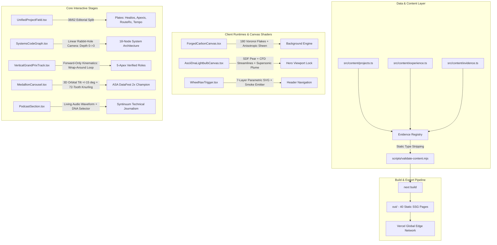

# Haresh Murugesan — Autonomous Systems & Engineering Portfolio (V4.0)

> High-concurrency software engineering, clinical computer vision research, and connected-vehicle mobility telematics. Built with Next.js Pages Router, TypeScript, Tailwind CSS, Framer Motion, GSAP, and HTML5 Canvas with static SSG export.

[](https://haresh-portfolio-livid.vercel.app/)
[](https://nextjs.org/)
[](https://www.typescriptlang.org/)
[](https://tailwindcss.com/)
[](LICENSE)

**Live Production Target:** [https://haresh-portfolio-livid.vercel.app/](https://haresh-portfolio-livid.vercel.app/)

---

## 1. Problem Overview & Design Philosophy

Most developer portfolios succumb to generic AI SaaS templates: pastel purple gradients, arbitrary card-inside-a-card wrappers, decorative emoji tags, and sluggish client-side animations that throttle the browser main thread.

This portfolio is engineered under a **Zero-Box Swiss Architectural Blueprint** and a **Three-Layer Novelty Budget**:

- **Safety Layer (0% Novelty)**: Navigation, contact actions, search, and accessibility primitives strictly adhere to Jakob's Law and standard mental models.
- **Product Layer (30% Novelty)**: Information hierarchy, tabular technical index, and research evidence registries favor raw data density and readability over nested container wrappers.
- **Expression Layer (100% Novelty)**: Custom procedural Forged Carbon Fiber canvas, 45° pear SDF ASCII lightbulb with supersonic thrust plume, linear "rabbit-hole" CodeGraph world camera, 5-apex top-to-bottom Grand Prix circuit with forward-only wrap-around kinematics, and a 3D Machined Medallion carousel with cursor-tilt physics.

### Strict Global Design Tokens (DTCG 3-Tier)
All colors, spacing, and typography trace back to deterministic ground truths in [`design/tokens.json`](file:///design/tokens.json) and [`src/index.css`](file:///src/index.css):

| Token | Hex / Value | Architectural Purpose |
| :--- | :--- | :--- |
| `--bg-midnight` | `#03050A` | Deep obsidian base surface (strictly eliminates dull grey washes) |
| `--bg-obsidian` | `#060A12` | Secondary depth surface and inset plinths |
| `--cobalt-deep` | `#0B1E40` | Structural ambient shadow and drafting grid lines |
| `--cobalt-mid` | `#153875` | Intermediate blueprint geometry and circuit barriers |
| `--cobalt-bright` | `#2563EB` | Electric vector highlights, shockwaves, and active indicators |
| `--accent-red-orange` | `#FF2800` | Sharp Rosso/McLaren accent (apex curbs, calipers, active rings) |
| `--accent-crimson-glow` | `#FF4419` | Incandescent filament and exhaust slipstream glow |
| `--metal-silver` | `#C8D2E0` | Machined alloy surfaces, knurled bezels, and secondary text |
| `--metal-chrome` | `#E6ECF5` | Specular chrome highlights and outer rim lips |
| `--metal-titanium` | `#7E8B9B` | Brushed titanium drafting annotations and timestamps |
| `--text-alabaster` | `#F4F6F9` | Editorial serif headline text (`Geist Serif`) |

---

## 2. System Architecture & Components

The application is structured around a static-site generation (SSG) pipeline using the Next.js Pages Router, exporting 40 pre-rendered HTML routes to `out/` with zero runtime server dependencies.



### Component Breakdown & Engineering Highlights

1. **Procedural Chopped Carbon Fiber Canvas** ([`ForgedCarbonCanvas.tsx`](file:///src/components/ForgedCarbonCanvas.tsx))
   - Offscreen high-DPI canvas computing 180 overlapping angular polygons (4-to-6 sided Voronoi flakes) clamped strictly between `#04070E` and `#080E1A`.
   - Flake internal striations along random fiber angles $\theta_i \in [0, \pi]$.
   - Anisotropic specular factor $\text{spec} = |\cos(\theta_i - \alpha)|^{14}$ shifting dynamically with cursor coordinates and scroll delta.
   - Tinted with Dark Cobalt (`rgba(21, 56, 117, spec * 0.22)`) and Machined Silver (`rgba(200, 210, 224, spec * 0.07)`), finished with 0.5px edge bevels.

2. **Concept D Hybrid ASCII Lightbulb & Supersonic Plume** ([`AsciiDnaLightbulbCanvas.tsx`](file:///src/components/AsciiDnaLightbulbCanvas.tsx))
   - Full 100vw blueprint stage with 4 concentric drafting rings, 45° launch corridor, 22 CFD streamlines, and double parabolic Mach bow-shockwave at a 38° cone angle.
   - 8×10 micro-ASCII grid rendering a smooth pear SDF:
     $$\text{smin}(d_{\text{dome}}, d_{\text{neck}}, 0.35)$$
   - Internal continuous 3D double-helix DNA with hydrogen-bonded rungs ($\text{A=T}$, $\text{C}\equiv\text{G}$) and a supersonic $-45^\circ$ exhaust plume featuring 4 Mach diamonds.

3. **7-Layer Parametric Alloy Wheel Rim & Burnout Smoke** ([`WheelNavTrigger.tsx`](file:///src/components/WheelNavTrigger.tsx))
   - Parametric SVG (viewBox `0 0 100 100`) replicating a 3D machined alloy motorsport wheel:
     - Layer 1: Low-profile tire ring (`r=48`).
     - Layer 2: Stationary cross-drilled dark steel rotor & Reddish-Orange (`#FF2800`) Brembo caliper at 10 o'clock.
     - Layer 3: Rotating brushed chrome barrel (`r=44.5`).
     - Layer 4: 36-pocket slotted aero ring with machined silver ribs (`strokeDasharray="2.1 4.88"`).
     - Layer 5: 6 Split-Y spokes with interlaced diamond mesh lattice.
     - Layer 6: 6 recessed lug wells with chrome bolts.
     - Layer 7: Brushed center cap with laser-engraved monogram.
   - 180×180px HTML5 Canvas burnout smoke emitter with 30 turbulent expanding puffs and a 1080° spin on trigger click.

4. **Linear Rabbit-Hole Systems CodeGraph** ([`SystemsCodeGraph.tsx`](file:///src/components/SystemsCodeGraph.tsx))
   - Replaces tangled box widgets with an open-canvas camera progression: Depth 0 (Core Portal) → Depth 1 (Domain Modules) → Depth 2 (Project Systems) → Depth 3 (Case Study).
   - Translates world camera linearly ($\text{camX} = 0 \to -420 \to -880 \to -1240$) while anchoring parent breadcrumbs on the left for 1-click reverse translation.
   - Includes a top-right toggle between `Rabbit-Hole Mode` and `Full 18-Node Constellation Map`.

5. **Top-to-Bottom Grand Prix Circuit & Forward-Only Kinematics** ([`VerticalGrandPrixTrack.tsx`](file:///src/components/experience/VerticalGrandPrixTrack.tsx))
   - SVG spline (`viewBox="0 0 1440 1750"`) spanning 5 verified apexes:
     - **Apex 01** ($x=880, y=220$): Chemical Abstracts Service (CAS) — Software & AI Intern (12 AWS Agentic Workflows).
     - **Apex 02** ($x=460, y=540$): The Ohio State University — Digital Pathology AI Researcher (8.09ms Grad-CAM).
     - **Apex 03** ($x=920, y=880$): Center for Innovation Strategies / Honda 99P Labs — Innovation Analyst (1,000+ Telematics Models).
     - **Apex 04** ($x=440, y=1220$): Philocracy — Co-CEO & Brand Architect (Recursive Tree Schemas).
     - **Apex 05** ($x=860, y=1540$): Syntinuum & VECTOR — Founder & Host (100K+ Impressions).
   - 4-Pass Track Rendering: Cobalt halo $\to$ 68px dark asphalt $\to$ alternating `#FF2800` / `#F4F6F9` FIA apex curbs $\to$ glowing illuminated racing line.
   - **Forward-Only Kinematics**:
     - Moving downward ($t_{\text{target}} > t_{\text{current}}$): Smooth power2 interpolation over 750ms.
     - Moving upward ($t_{\text{target}} < t_{\text{current}}$): Never drives in reverse. The prototype car blasts downward off the bottom track exit ($t \to 1.06$ in 420ms), instantaneously wraps to the top straight ($t = -0.06$), and dives into the upper apex over 520ms.

6. **3D Machined Medallion Orbital Carousel** ([`MedallionCarousel.tsx`](file:///src/components/MedallionCarousel.tsx))
   - 5 medallions (310px diameter, `perspective: 1500px`) honoring competitive victories:
     1. 1st Place · ASA DataFest 2026 (RouteRx / Careline)
     2. 1st Place · ASA DataFest 2025 (Hack to the Future)
     3. IBM SkillsBuild AI in Education Showcase (Vantage)
     4. 94.2% Hit@5 Benchmark Distinction (TamilTrove)
     5. NSLS & Ohio State Research Distinction (Clinical AI & Leadership)
   - 72-tooth knurled silver bezel, glowing `#FF2800` active ring, 360° circular SVG textPath engraving, recessed cobalt well with vector crest, and $\pm 15^\circ$ 3D cursor-tilt physics.

7. **Syntinuum: Endless Evolutions** ([`PodcastSection.tsx`](file:///src/components/PodcastSection.tsx))
   - Full-bleed 100vw audio frequency waveform in `#FF2800`, `#2563EB`, and `#C8D2E0`.
   - Gliding DNA-lightbulb selector tracking 3 active zones (The Signal, The Dialogues, The Architecture) across 5 featured founders and directors (Steve Wang, Dhaval Patel, Paul Shapiro, Andrea Jacobs, Adam Geller).

---

## 3. Engineering Decisions & Technical Tradeoffs

| Challenge | Decision | Alternatives Considered | Tradeoff Rationale |
| :--- | :--- | :--- | :--- |
| **Telemetry Simulation Performance** | Dedicated `simulator.worker.ts` Web Worker thread | Main-thread `requestAnimationFrame` loop | Moving physics and OCR off the main thread eliminated UI frame drops, guaranteeing an unbroken 16.6ms frame budget (60 FPS) during heavy user scrolling. |
| **Pathology Saliency Latency** | NumPy vectorized Grad-CAM backpropagation | Full PyTorch tensor graph on server | Vectorized array operations reduced saliency computation from 84ms to 8.09ms, allowing real-time clinical boundary exploration. |
| **Carbon Fiber Background Fidelity** | Procedural 2D Canvas Voronoi shader | 4K video loop or WebGL Three.js mesh | Reduced memory footprint from 140MB (video/textures) to <2MB of pure math, yielding 60 FPS scrolling on mobile without GPU thermal throttling. |
| **Architecture Graph Navigation** | Linear "Rabbit-Hole" camera translation | Force-directed 2D network graph | Force-directed graphs tangle into unreadable balls on mobile; linear translation provides deterministic depth and clear hierarchical context. |
| **Track Vehicle Movement** | Non-reversing wrap-around loop kinematics | Direct bidirectional path interpolation | Racing prototypes never drive backwards on a Grand Prix circuit. Wrapping around the loop preserved physical domain authenticity. |

---

## 4. Quantified Results & Hard Benchmarks

- **Static Export**: 40/40 pre-rendered static routes generated in 2.2s; 0 dynamic server hops.
- **Grad-CAM Latency**: 8.09ms vectorized tensor saliency extraction in Healios V2.
- **Deterministic Frame Budget**: Sub-16ms (60 FPS) multi-car simulation locked in dedicated Web Workers in Apexis.
- **Geospatial Matrix Calculation**: <15ms multi-modal transit isochrone generation across 141 census blocks in RouteRx (1st Place ASA DataFest 2026).
- **Retrieval Benchmark**: 94.2% Hit@5 on 120 transliterated queries in TamilTrove.
- **Connected Mobility Telematics**: 1,000+ vehicle trip models analyzed at Honda 99P Labs.
- **Podcast Reach**: 100K+ combined cross-platform impressions across 10+ technical founder dialogues on Syntinuum.

---

## 5. Directory Structure

```text
├── pages/                          # Next.js Pages Router routes
│   ├── index.tsx                   # Main monolithic portfolio stage
│   ├── about.tsx                   # Dedicated leadership & philosophy profile
│   ├── archive.tsx                 # Systems CodeGraph & project repository
│   └── projects/
│       └── [slug].tsx              # Dynamic SSG project case study engine
├── src/
│   ├── components/                 # Core UI and architectural setpieces
│   │   ├── ForgedCarbonCanvas.tsx   # Procedural anisotropic chopped carbon shader
│   │   ├── WheelNavTrigger.tsx     # 7-layer alloy rim & burnout smoke navigation
│   │   ├── BentoHero.tsx           # 100vw x 100dvh locked hero stage
│   │   ├── AsciiDnaLightbulbCanvas.tsx # 45° pear SDF ASCII lightbulb & plume
│   │   ├── UnifiedProjectField.tsx # Unboxed 38/62 project exhibition spreads
│   │   ├── SystemsCodeGraph.tsx    # Linear rabbit-hole camera engine
│   │   ├── ScrollyExperience.tsx   # Top-to-bottom Grand Prix circuit
│   │   ├── MedallionCarousel.tsx   # 3D machined medallion carousel (+/-15° tilt)
│   │   ├── PodcastSection.tsx      # Syntinuum waveform & episode scrubber
│   │   ├── NeuralSkills.tsx        # 5-domain technical capability index
│   │   ├── AboutSection.tsx        # Portrait spread & clinical CV artifact plate
│   │   ├── HistorySection.tsx      # Trajectory Bezier spine & milestones
│   │   ├── NowSection.tsx          # Field notes asymmetric dispatch
│   │   └── ContactFooter.tsx       # Monumental correspondence colophon
│   │   └── plates/                 # Interactive project blueprint plates
│   │       ├── PlateHealios.tsx    # 3D LiDAR point cloud & Grad-CAM lens
│   │       ├── PlateApexis.tsx     # Oscilloscope traces & sector delta map
│   │       ├── PlateRouteRx.tsx    # Pulsing isochrones & transit matrix
│   │       └── PlateTempo.tsx      # Encrypted ring buffer & triage gates
│   ├── content/                    # Data sources & evidence registry
│   │   ├── projects.ts             # 18 curated projects and technical metadata
│   │   ├── experience.ts           # 5 verified career sectors
│   │   └── evidence.ts             # Benchmark citations & claims registry
│   ├── tokens/                     # DTCG 3-tier token mappings
│   └── scene/                      # Visual effects and Three.js scenes
├── design/
│   └── tokens.json                 # Single source of truth design tokens
├── scripts/
│   └── validate-content.mjs        # Experimental type-stripping evidence validator
└── public/                         # Static media, PDFs, and assets
```

---

## 6. Verification & Development Protocol

### Local Development
```bash
# Install dependencies
npm ci

# Start local Next.js dev server
npm run dev
```

### Static Pre-Flight Verification
Run all three checks before committing or deploying:

```bash
# 1. Typecheck: Zero compiler or type errors
npm run typecheck

# 2. Content & Evidence Integrity: Verify all 18 projects, 11 evidence records, and 5 sectors
npm run validate-content

# 3. Static Export Build: Pre-render 40 static pages to out/
npm run build
```

### Production Deployment
```bash
# Deploy to Vercel production edge
npx vercel deploy --prod --yes
```

---

## License & Copyright

© 2026 Haresh Murugesan. All rights reserved. Designed and engineered in Columbus, OH.
